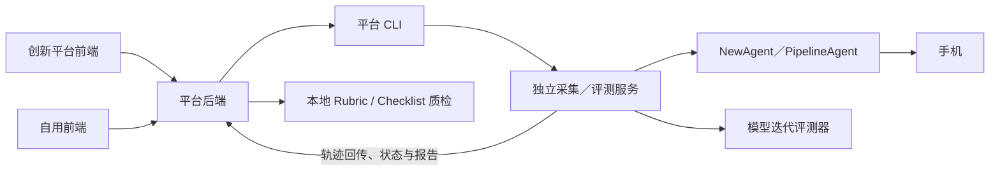

# Agentic Data Flywheel

**项目总文档 · 最近核对：2026-11-13。** 本文件是项目架构、开发交接、配置、使用和当前进展的统一入口，随功能改动持续更新。专题文档保留接口和实现细节，不替代本文件中的项目现状。

一个前后端分离的 GUI Agent 轨迹数据飞轮工程，覆盖任务生成与扩增、手机采集与回传、轨迹预处理与标框、建树与质检、专家纠偏、COT、数据发布、云道上传和训练数据总览。

平台运行数据默认位于项目根目录的 `backend_workspace/`，可用 `ADF_DATA_ROOT` 指定：SQLite 保存当前状态，JSON 在流程间流转，各阶段保留 Excel 核对表。后端不扫描旧目录、不从旧 JSON 恢复状态；必需 JSON 缺失时明确失败，不回退 Excel。目录、命令、显式资源准备和产物读取接口见[统一数据存储说明](DATA_STORAGE.md)。

手机工厂提供采集、设备监控与模型迭代评估，运行结果通过 HTTP 回传平台。平台接入入口见[手机工厂说明](PHONE_FACTORY.md)。实际采集端单独交付，部署以现场启动工程、能力接口和匹配的增量包为准；[仓库内独立服务说明](backend/collector_service/README.md)描述该参考实现，不能据此直接覆盖内网运行工程。

自动流程、采集及评测页面的摘要索引、分页、缓存与创新前端接入见[页面加载说明](PAGE_LOADING.md)。

## 系统边界与数据主线

| 部分 | 职责与修改位置 |
| --- | --- |
| 创新平台前端 | 独立维护的接入方；沿用其 API_BASE_URL、网关前缀、路由及组件体系。本仓库提供接口适配说明，不全量覆盖其源码。 |
| 本仓库自用前端 | `frontend/`，Vue + TypeScript + Vite；处理表单、展示和轮询。 |
| 平台后端与 CLI | `backend/`，FastAPI；管理批次、作业、数据、质检、修正和发布；通过 `phonefactory_client.py` 调用采集服务。 |
| 独立采集／评测服务 | 实际采集工程负责手机执行、封存、回传及现有模型迭代评估。轨迹质检已迁到平台，不再依赖此服务；常用端口为 9011，实际地址以配置为准。 |
| 平台质检工程 | 后端 `DevelopRubrics` 与 `ChecklistEvaluator`，独立子进程执行 Rubric、Checklist，平台统一计算 F/Q、保存部分结果和报告。 |
| 执行引擎 | NewAgent、PipelineAgent 位于采集工程中。评测服务变更不必然意味着手机执行逻辑变化，交付必须分别说明。 |



主数据链路：任务来源 → 冻结采集计划与结果批次 → 逐条原件回传 → 预处理／标框 → Observation／轨迹树 → Rubric／Checklist 质检 → 人工纠偏／COT → 冻结发布 → 云道上传／看板汇总。

已有轨迹独立评测直接读取可访问的原件，日志和报告另存，不重新操作手机，也不通过复制整批轨迹准备输入。采集执行、回传、归档、评测和上传各自记录状态；其中一项成功不代表其余项目完成。

开发时必须区分：任务来源、结果批次、逻辑运行、计划实例（原用例＋手机＋重复序号）、执行尝试、封存产物和结果快照。重试回传不重新采集；续采追加执行尝试并保留旧证据；默认配置只初始化新运行，历史重放和续采使用原冻结配置。

## 模块与专题索引

| 主题 | 入口文档 |
| --- | --- |
| 数据目录、阶段产物、数据库与发布保护 | [DATA_STORAGE.md](DATA_STORAGE.md) |
| 手机工厂和平台集成 | [PHONE_FACTORY.md](PHONE_FACTORY.md)、[采集运行](backend/COLLECTION_RUNS.md) |
| 任务来源、采集批次 | [统一任务输入](backend/task_generation/COLLECTION_INPUT.md)、[来源批次](backend/task_generation/COLLECTION_BATCHES.md) |
| 预处理与外部轨迹接入 | [批次预处理](backend/PREPROCESSING.md)、[已有 Rollout 导入](backend/ROLLOUT_IMPORTS.md) |
| 自动流程、阶段恢复与诊断 | [AUTOMATIC_PIPELINE.md](AUTOMATIC_PIPELINE.md)；新融合选轨规则见下一行 |
| Rubric／Checklist 融合、Top-1、树节点 Q | [QUALITY_FUSION.md](QUALITY_FUSION.md) |
| 坐标展示与人工取点 | [COORDINATE_DISPLAY.md](backend/COORDINATE_DISPLAY.md) |
| 页面摘要、分页、缓存与后端索引 | [PAGE_LOADING.md](PAGE_LOADING.md) |
| 云道上传、脚本配置与上传范围 | [INTERNAL_UPLOAD.md](backend/data_publishing/INTERNAL_UPLOAD.md) |
| 外部表格发布、历史数据和训练看板 | [EXTERNAL_IMPORTS.md](backend/data_publishing/EXTERNAL_IMPORTS.md)、[训练数据总览](backend/training_data_overview/README.md) |

专题中的历史验收记录只证明当时版本。接口字段、能力版本、目录和有效模型配置以目标版本代码及现场能力响应为准；发现不一致时应同步修正文档，不能直接把旧示例当成新部署步骤。

## 配置与交付约定

| 配置 | 管理位置 |
| --- | --- |
| 平台预处理、建树、Rubric、COT | 平台 `backend/.env` 和各模块配置；Rubric 专用 Python 由 `ADARUBRIC_PYTHON` 指定，见下文。 |
| 手机执行模型与 Pipeline 规划模型 | 手机工厂配置及采集端能力；新请求显式覆盖时按角色冻结，不能顺带改其它内部角色。 |
| Checklist 文本／视觉评测模型 | 在“轨迹质检”独立保存模型、URL、密钥环境变量名及本地规则；首次迁移复制已有模型默认值，此后与模型迭代分开。真实密钥在平台后端环境中，解释器由 `ADF_CHECKLIST_PYTHON` 指定。 |
| 云道上传 | 平台后端配置上传 Python、脚本、token、region、bucket；页面允许调整目标前缀，见上传专题。 |
| 数据根与访问地址 | `ADF_DATA_ROOT`、平台／采集服务地址及前端代理；端口和模型名示例不是必须使用的固定值。 |

默认交付边界为平台直接改源码、采集端单独增量包、创新平台提供适配说明；每次仍须写明本次实际范围。增量包核对基线，不同基线逐段合并，保留内网配置和增强。开发、离线测试、部署和真机验收分别记录；不把测试通过写成已部署。新增文件必须与修改文件一起同步，不只复制已有同名文件。

平台当前状态与过程件分别保存在 `<DATA_ROOT>/system/app.sqlite` 和 `<DATA_ROOT>/batches/`；回传原件在 `<DATA_ROOT>/raw/collection_batches/`，外部原始输入通常在 `<DATA_ROOT>/raw/rollout_trajectories/`。独立采集工程的 `.http_runs`、归档和设备工作目录不属于平台数据根。清理需按明确运行／批次及其归属执行，不连带删除共享手机工程、平台原件或外部输入。

缺 XML 等质量问题保留原件并判断用途；身份、路径、清单、摘要不一致则隔离。训练预处理和发布资格不因放宽原件接收而自动变化。耗时扫描、压缩、下载和模型请求进入后台；页面优先读摘要，缓存只用于展示，控制操作仍核对权威状态。

## 当前进展与维护记录

| 日期 | 改动及范围 | 验证／部署状态 |
| --- | --- | --- |
| 2026-11-13 | 质检详情布局：加宽右栏、统一深色评分配色，Checklist 全部检查项摘要常驻、证据逐项展开；按真实有效 F 高亮一条最高分轨迹，并列可切换。评分刷新保留节点、截图选择及树视口。仅自用前端与文档。 | 验证、提交说明及创新前端适配见 [页面交付](docs/quality-ui-20261113/README.md)。沿用上一轮坐标后端，不改采集端、评分公式或数据；内网坐标 JSON 和真实点位仍需现场核验。 |
| 2026-11-13 | 轨迹质检迁平台：本地隔离 Checklist 工程、冻结原始用例和条件、逐条检查点与部分结果、旧作业关联重试、真实阶段进度；质检树坐标复用原 GET 路由并修复重复请求。只修改平台前后端，不改采集端和模型迭代。 | 定向离线验证及真实隔离子进程模拟模型验证见 [交付验证](docs/quality-local-20261113/VALIDATION.md)。内网现有十轨迹、真实模型及 icap 待验；部署与本批恢复见 [质检专题](QUALITY_FUSION.md)。 |
| 2026-11-13 | Checklist 纯任务修复：清单改取冻结 context.task_description，兼容旧已知包装，避免将 Rubric 系统提示词误当任务；原件、Rubric 输入及检查点保持不变。仅平台后端一个生产文件。 | 修正后的清单产生新内部 Checklist 请求，旧错误定义保留但不复用；原批次重试质检即可。59 项定向测试通过，含两引擎实际预处理到采集端校验、旧错误清单隔离及十轨迹 Rubric 复用；真实模型仍待现场验收。 |
| 2026-11-13 | Checklist 原始错误透传：保留采集端失败行的具体错误，避免非空 Checklist 定义遮蔽真实原因；补齐平台回传目录的 9011 输入根配置说明。仅平台后端一个生产文件，前端与采集端源码无新增变更。 | 现场已确认原件存在但不在允许读取目录内；目录配置需在 9011 启动环境生效后重试原质检，真实模型结果待验。定向测试 31 项通过（单测 12、真实 CLI/Flask 契约 3、评分与推进回归 16），含修正目录配置后原请求恢复；不改变整批推进、评分公式或冻结输入。 |
| 2026-11-13 | Checklist 配置适配补丁：采集服务质量作业调用 `normalize_config` 补传 URL 规范化函数；测试改为真实 manager 工厂/配置函数，修复合法配置被 HTTP 400 拒绝。交付 `collector-quality-config-fix-20261113.zip`，平台无新增生产代码变更。 | 旧代码真实路由复现同一错误；采集端 11 项＋平台 CLI/HTTP 契约 1 项＋评测器 3 项通过，无跳过。内网部署后仅重试 `b261112-004` 原质检阶段，保留原输入、配置及可复用 Rubric；真实 Checklist 待验。 |
| 2026-11-13 | 融合评分恢复：修复质检原件相对路径解析，兼容旧树快照；自动流程重试继承原 Checklist 冻结配置，失败时展示具体原因和部分评分。仅平台后端、自用前端。 | 后端两组 119／50 项（去重 153 项）、前端 37 项及类型检查／构建通过；含旧快照 10 条轨迹补 Checklist、Rubric 不重复调用且原件／快照／检查点不变。内网 `b261112-004` 待实际重试验收。无需重采、重预处理或重建树，不需要新采集端包。恢复与适配见 [QUALITY_FUSION.md](QUALITY_FUSION.md#原件路径恢复与失败结果展示2026-11-13)。 |
| 2026-11-12 | 质检融合：平台接入现有 Checklist，计算 F/Q，更新 Top-1，保护旧草稿；9011 新增只读质检后台任务。 | 平台已写入工作区、采集端增量包已生成。后端两组 82／38 项、采集端 49 项、前端 87 项及类型检查／构建通过。真实模型、内网网关和浏览器视觉待验；本地未执行部署。详见 [QUALITY_FUSION.md](QUALITY_FUSION.md)。 |
| 2026-11-12 | 平台标框复核：明确执行像素与输出归一化坐标，校验实际动作点，补齐失败响应和转换诊断、有界纠正及托管重试预算。 | 76 项相关后端测试通过，含 1200×2640、点击 (1080,238) 的现场几何条件。真实截图内容与模型返回待内网复现核验。同步范围为平台后端，说明见[标框诊断](backend/PREPROCESSING.md#标框固定步骤失败的诊断与纠正2026-11-12)。 |
| 2026-11-12 | 建立本 README 作为项目总文档，补齐架构、索引、配置与维护约定，修正过时的质检／上传描述，并同步自动流程专题中的新旧排序规则。 | 仅文档改动；核对本地链接、代码入口和 Markdown 结构，不重跑业务测试。 |

本轮下一步：同步平台后端（包括新增 `ChecklistEvaluator` 工程）和自用前端，在平台配置 Python/依赖、模型密钥环境变量并导入原规则。对仍活动的旧质检先停止并对账，再在 `b261112-004` 原质检阶段重试；复用 Rubric，补 Checklist/F/Q，不重采、不重建树。新质检不再要求采集端能力或 allowed_roots 配置，不需要本轮采集端增量包。配置、创新前端适配和真实验收见 [QUALITY_FUSION.md](QUALITY_FUSION.md)；内网运行结果仍待验。

**后续维护方式：** 每次相关功能修改都先读本文件，完成后在同一次交付中更新受影响的项目现状、配置／边界和本节记录；详细接口、排障步骤、测试命令放入对应专题并在总索引链接。记录至少写日期、功能、涉及哪一端、同步步骤、已验证项和待验项。单纯文案／样式修正只写必要摘要，不强制重跑采集全链。近期记录保持简短，历史通过 Git 和专题追溯，不把所有聊天内容复制成无限增长的流水账。

## 主要能力

- 递归读取 rollout 轨迹并导出 Excel。
- 为 `click`、`swipe`、`long_press` 动作生成并复核 bbox。
- 使用 Qwen 判断广告、加载、弹窗等临时中间状态。
- 在仅忽略短暂插入状态的前提下构建 action 前缀树。
- 在网页中按真实场景能力树生成、审核和导出任务。
- 上传失败任务并自动匹配场景、扩增变体任务。
- 在网页中浏览任务、轨迹、步骤截图和动作标注。
- 在线修改 bbox，保存当前标注并形成同版本 JSON/Excel 中间产物。
- 批量提交任务建树，在质检页面查看分叉、occurrence 和中间态审计。
- 复用现有 Checklist 评测器，展示 Rubric 维度、融合分 F 和各步骤 Q；新结果按 F 推荐 Top-1。
- 在网页中直接修正 Action 和步骤，并按 SFT/RL/原生数据分流导出；SOP/COT 由后续模型生成。
- 冻结发布表格与选中轨迹范围，后台上传云道并汇总训练数据看板。

## 目录结构

```text
AgenticDataFlywheel/
├─ backend/                       FastAPI、轨迹预处理和建树代码
│  ├─ bounding_box/              bbox 生成与视觉复核
│  ├─ trajectories_tree/         中间态判断和轨迹树构建
│  ├─ task_generation/           任务生成与任务扩增网页模块
│  ├─ trajectory_correction/    轨迹修正网页模块（独立后端包）
│  ├─ tests/                     后端测试
│  ├─ .env.example               模型配置示例
│  └─ api.py                     FastAPI 入口
├─ frontend/                     Vue 3 + Vite 前端
├─ backend_workspace/            统一数据根目录，不提交 Git
│  ├─ system/app.sqlite          当前状态、编辑与产物索引
│  ├─ raw/rollout_trajectories/   原始轨迹放置目录
│  ├─ batches/                   按批次、阶段保存唯一当前 JSON/Excel
│  ├─ releases/                  发布时冻结的 Excel 副本
│  └─ resources/                 场景树和先验知识库
└─ README.md
```

## 1. 获取代码并安装依赖

要求 Python 3.10 或更高版本，以及符合 Vite 7 要求的 Node.js 20.19+ 或
22.12+。

```powershell
git clone https://github.com/Jiawen9/AgenticDataFlywheel.git
cd AgenticDataFlywheel
python -m pip install -r backend\requirements.txt
npm install --prefix frontend
```

## 2. 配置模型服务

复制示例配置：

```powershell
Copy-Item backend\.env.example backend\.env
```

编辑 `backend/.env`：

```dotenv
YUNAI_API_KEY=你的_api_key
MODEL_URL=https://yunai.chat/v1
MODEL_NAME=qwen3.6-27b:floor
COT_MODEL_NAME=qwen3-vl-32b-instruct
```

前三个通用变量是必填项，COT 模型可单独配置：

- `YUNAI_API_KEY`：OpenAI-compatible 模型服务的 API key。
- `MODEL_URL`：模型服务的 base URL。
- `MODEL_NAME`：预处理和建树使用的模型名称。
- `COT_MODEL_NAME`：专家纠偏后生成 Thought/Summary 使用的视觉模型；未配置时默认使用 `qwen3-vl-32b-instruct`，不会改变标框和建树模型。

`backend/.env` 已被 Git 忽略，不要把真实密钥写入 `.env.example`、源码或日志。

轨迹末尾摘要、质检（Rubrics 生成与评分）和 COT 默认不读取环境变量中的
`HTTP_PROXY` / `HTTPS_PROXY` 或 Windows 系统代理，更新后端后无需在启动窗口设置
`NO_PROXY=*`。SDK 原有超时和重试设置保持不变。需要代理时可在 `backend/.env`
显式填写 `HTTP_PROXY_URL=http://代理主机:端口`；或设置 `HTTP_TRUST_ENV=true` 继承
系统代理。质检和 COT 可分别使用 `ADARUBRIC_HTTP_*`、`COT_HTTP_*` 覆盖通用值，
优先级为模块进程环境、模块文件配置、通用进程环境、通用文件配置；空值表示清空。
标框、状态分类和对齐继续使用现有 `TRAJECTORY_VLA_HTTP_*` / `TRAJECTORY_HTTP_*`
配置，默认也不读取系统代理。修改网络配置后应重启平台后端。

## 3. 放置原始轨迹

先将本次要处理的原始任务目录显式复制到下面的路径，确认不会覆盖同名输入。保留完整任务／轨迹层级及截图、XML、响应文件；不要复制旧标框结果、作业记录、质检结果或缓存。后端不会自动查找旧目录。

```text
backend_workspace/raw/rollout_trajectories/
```

预期结构示例：

```text
backend_workspace/raw/rollout_trajectories/
└─ AT-YYSP-AQY-001/
   ├─ AT-YYSP-AQY-001-1/
   │  ├─ step001_vla_input_stability.jpg
   │  ├─ step001_vla_input_ui.xml
   │  └─ ...
   └─ AT-YYSP-AQY-001-2/
      └─ ...
```

原始轨迹、截图、XML、模型请求和响应都属于本地数据，不会上传到 GitHub。

## 4. 预处理轨迹

前端入口为“轨迹采集 → 轨迹预处理与建树”：选择已完成采集登记的批次，点击“开始预处理”，可查看进度、下载初始表、失败重试并继续建树。手机采集端按 [采集完成协议](backend/COLLECTION_RUNS.md) 落盘并登记结果；完整接口及保存规则见 [批次预处理](backend/PREPROCESSING.md)。

在项目根目录运行：

```powershell
python backend\trajectories_preprocessing.py --batch-id processing-demo-001
```

处理流程为：

1. 递归读取正式轨迹并忽略 `_prefetch_staging` 等临时目录。
2. 在 `backend_workspace/system/preprocessing/<批次号>/<执行编号>/` 生成初始表，并保存转换阶段 JSON/Excel 快照。
3. 为目标动作生成候选 bbox，并调用 Qwen 复核。
4. 在同一执行目录生成标框表，并保存标框阶段 JSON/Excel 快照；各批次与执行互不覆盖。

有效模型响应会写入本地缓存，无效响应及坐标转换过程保存为独立、有界的标框诊断。调用中断后可再次执行命令续跑；任一目标动作标框失败时，
不会发布不完整的标注 Excel。

如需自定义输入、输出或配置文件，可查看全部参数：

```powershell
python backend\trajectories_preprocessing.py --help
```

## 5. 开发模式运行

在第一个 PowerShell 窗口启动后端：

```powershell
python -m uvicorn backend.api:app --reload --host 127.0.0.1 --port 8765
```

在第二个 PowerShell 窗口启动前端：

```powershell
npm run dev --prefix frontend
```

访问地址：

- 前端：`http://localhost:5173`
- 后端：`http://127.0.0.1:8765`
- API 文档：`http://127.0.0.1:8765/docs`

Vite 默认把 `/api` 代理到 `http://127.0.0.1:8765`。

## 6. 网页使用流程

### 任务生成与任务扩增

任务生成页面读取以下本地知识库：

```text
backend_workspace/resources/task_generation/KnowledgeBase/
├─ VLA场景树.xlsx
├─ APP操控先验知识库.xlsx
└─ APP资源先验知识库.xlsx
```

进入“场景能力树”，按 **场景 → 一级能力 → 任务类型** 浏览。点击节点查看详情，勾选节点选择生成范围；App 不再作为树的根节点。任务类型数量按路径去重，App 数量单独计入执行单元。

- 点击“编辑场景树”可新增、重命名、删除三级节点，并按 App 编辑参考示例、资源先验开关。修改统一保存或取消，离开页面前会提示未保存内容；编辑期间不能提交生成。
- 每个选中任务类型默认勾选全部适用 App，可逐项取消。例如一个任务类型选择三个 App、数量设为 5，预计生成 15 条主任务；弱依赖前置任务另计。
- 空场景、空能力和未配置 App 的任务类型可以保存，后者不可生成。缺少操控或资源先验会显示提示，不阻止其他已就绪配置的生成。
- 生成完成后可编辑任务文本、成组删除/恢复弱依赖任务并导出 Excel。已有作业使用提交时的快照，不受后续知识库编辑影响。

首次使用前，显式放入上述三个资源 Excel，或通过页面上传；系统不会从旧目录复制知识库。需要沿用已有节点 UUID 时，可以显式复制完整知识库版本目录及 `current.json`。系统从已提供的资源初始化知识库版本，之后 **`KnowledgeBase/current.json` 指向的 `versions/<版本>/` 才是当前有效知识库**；请通过网页替换文件，不要直接修改根目录原文件或版本目录。
每个版本保存三份 Excel 和 `scene_tree.json`（稳定 UUID 与树结构），通过原子切换版本指针一起发布。改名同步更新操控先验路径；删除节点或移除 App 不删除已有先验记录。旧版本目录完整保留，作为备份。

知识库卡片支持单文件替换和“下载已保存场景树”。下载文件保留六个业务列，并带有隐藏的 `_scene_tree_nodes` sheet，用于保留节点 UUID、空分支及无 App 的任务类型；回传时请保留该 sheet。普通六列表仍支持导入，相同路径复用当前 UUID。不同 App 的示例/资源配置分别保存，同一任务类型/App 出现冲突行时拒绝导入并提示修正。多个标签页同时保存时，旧版本请求返回 `409`，不会覆盖新版本。

场景树接口：`GET /api/task-generation/tree` 返回 `version/scenes/leaf_count/execution_unit_count/warnings`；`PUT` 同路径接收 `base_version/scenes`；`GET /api/task-generation/tree/export` 下载当前 Excel。生成提交采用 `{version, selections: [{node_id, apps}], generate_n}`，不再使用 App 展开的 `node_ids`；业务作业读取接口地址不变，只返回新存储中的记录。

如需无模型费用、无业务数据改动的页面验收，先构建前端，再运行 `python -m backend.tests.scene_tree_demo_server --port 8791`，访问 `http://127.0.0.1:8791/task-generation/scenario-tree`。该验收服务把知识库复制到临时目录，并使用模拟模型；按 Ctrl+C 结束后清理临时数据，不应将其作为正式服务运行。

进入“任务扩增”后上传失败任务 Excel。原始表需要包含 `任务`、`涉及APP`，如果存在 `任务结果` 列则只扩增非 `TRUE` 行；也可以直接上传含有 `app/task/scene/capability/sub_capability` 的 `新场景匹配` 表。扩增结果同样可以审核、删除和导出。

扩增页默认展示紧凑的关联场景树，可切换查看全部场景；变体审核按源失败用例分组，展开后再查看和编辑变体。父组每页 20 条，已删除变体仍可展开恢复。分组、折叠与场景筛选仅影响展示，导出及提交采集始终包含全部未删除结果。

普通生成和扩增均提供 `GET /api/task-generation/jobs/{job_id}/collection-input`，读取当前全部未删除任务及最新人工修改，供采集模块后续接入。字段、依赖校验和响应示例见[统一任务读取接口文档](backend/task_generation/COLLECTION_INPUT.md)。

在生成结果中点击“提交轨迹采集”会冻结当前任务为采集批次，并生成规定的 17 列采集 Excel；手机工厂采集页可选择批次运行。每个作业只提交一份批次，后续源任务编辑不改变已提交内容，原有 Excel 导出保留。批次存储、接口和运行接入方式见[采集批次对接文档](backend/task_generation/COLLECTION_BATCHES.md)。

任务生成状态、结果和源用例保存在 `backend_workspace/system/app.sqlite`，不双写作业／结果 JSON。文件产物保存在：

```text
backend_workspace/system/task_generation/
├─ runs/       # 知识库快照、输入文件和模型调用诊断
├─ exports/    # 业务接口导出的任务 Excel
└─ collection_batches/ # 已提交的采集 JSON 和 17 列 Excel
```

阶段当前过程件保存到 `backend_workspace/batches/<job_id>/`；日志保存到 `backend_workspace/logs/task_generation/`。生成／扩增仍调用原 `/jobs/{job_id}/export` 业务地址，后端保存到新数据目录；浏览器下载副本的位置由浏览器决定。

手机采集仅读取 SQLite 状态和 `backend_workspace/inputs/phone_factory/` 上传文件。没有状态时返回空列表和默认配置。需要一次性保留设备配置时，显式调用 `PhoneFactoryStore().initialize_settings(...)`，仅接受 `phones/apps/phoneApps/vla/config`，不导入任务或运行记录，也不覆盖已有状态；示例见[统一数据存储说明](DATA_STORAGE.md#手机设备和配置的一次性准备)。

如需使用不同模型，可在 `backend/.env` 中设置 `TASK_GENERATION_MODEL_NAME`、`TASK_GENERATION_MODEL_URL` 和 `TASK_GENERATION_API_KEY`；未设置时回退到通用 `MODEL_NAME`、`MODEL_URL` 和 `YUNAI_API_KEY`。并发数使用 `TASK_GENERATION_MAX_CONCURRENT`，默认值为 4。

模型输出处理与排查：

- 默认只接受最终答案，不将 `reasoning_content/reasoning` 当作任务。`finish_reason=length` 会明确报截断；纯 JSON、JSONL、单个 Markdown JSON 块和 `</think>` 后的完整答案仍可读取。混杂分析和多个示例块的响应会要求模型重新输出，不再猜测提取第一个 JSON。
- 生成与扩增统一要求 `{"tasks":[...]}`，每项包含真实 `task`。占位符、空白、非法字段和重复任务不会保存。默认允许一次校验补生成，由 `TASK_GENERATION_VALIDATION_RETRIES` 控制；这是网络重试之外的额外模型调用，设为 `0` 可关闭。数量仍不足时保留有效结果并报部分成功，无有效结果则失败。
- 依赖枚举必须是 `zero/weak/strong` 中的一个；判定失败或弱依赖前置任务无效时，不再伪装成无依赖，该任务不进入可导出结果，错误中说明原因。历史结果不自动清洗或改写。
- 初始/扩增输出预算默认 `TASK_GENERATION_GENERATION_MAX_TOKENS=8192`，依赖与分类默认 `TASK_GENERATION_CLASSIFICATION_MAX_TOKENS=2048`。模型名、地址、密钥保持原配置。第三方推理开关用 `TASK_GENERATION_EXTRA_BODY` 配置，只有确认支持后再填；`TASK_GENERATION_JSON_MODE=true` 同理，不默认强制启用。
- 每次实际请求的 Prompt、参数、模型响应（包含最终内容、推理字段、usage、结束原因）保存在 `runs/<job_id>/model_calls/<trace_id>.json`；错误信息附诊断文件名。非作业直接调用时写入 `logs/model_calls/`。文件原子发布，多个并发请求独立记录，不新增公共下载接口。
- 诊断日志默认开启，可设 `TASK_GENERATION_TRACE_ENABLED=false` 关闭。记录会隐藏配置密钥及常见认证字段，但仍包含业务任务、先验与模型文本，属于本地敏感数据，不应直接上传或分享；可按需手动归档清理。旧作业只有原来的日志，无法补回过去未记录的原始响应。

### 轨迹采集

1. 进入“轨迹采集 → 轨迹预处理与建树”，选择已登记的批次，查看其冻结 JSON 中的任务和轨迹；未登记的目录不会自动出现在页面。
2. 展开任务并选择一条轨迹，按需查看每一步截图、action、summary 和 bbox。
3. 点击截图右上角的“修改 bbox”，重新绘制并保存当前动作框；系统保存当前标注，更新同一份 JSON/Excel 及内部修订号，并只失效该任务的建树及后续结果。
4. 勾选一个或多个已预处理任务并提交建树，等待后台作业完成。

### 轨迹质检

1. 选择已有当前建树结果的业务批次。
2. 选择具体任务，查看以桌面为统一起点的 action 前缀树。
3. 选择 Checklist 规则并提交质检；Rubric 使用平台现有配置，Checklist 使用“模型迭代评估”保存的文本／视觉模型配置。
4. 点击节点查看 action、summary、bbox、分类和 occurrence 截图。新评分每个节点显示 Q，终点按轨迹分别显示维度、G、Checklist 和 F；历史结果不伪造 F/Q。
5. 在中间态审计中查看未计入树的短暂广告、加载或弹窗步骤。

当前 Observation、轨迹树、质检分别保存到业务批次的阶段产物：

```text
<DATA_ROOT>/batches/<batch_id>/03_observation/
<DATA_ROOT>/batches/<batch_id>/04_tree/
<DATA_ROOT>/batches/<batch_id>/05_quality/
```

作业状态保存在 SQLite；产物文件名、摘要和来源以各阶段 manifest 为准，不从时间戳目录猜测当前结果。公式、字段和部署见 [QUALITY_FUSION.md](QUALITY_FUSION.md)。这些都是本地运行产物，不提交 GitHub。

### 轨迹修正

进入“轨迹纠偏 → 专家动作纠偏”，选择已质检批次。新融合结果按有效 F 选择每任务 Top-1，同分保留原工作簿顺序；历史 Rubric 结果保留原排序。已有批次自动恢复原草稿和入选轨迹，不用新推荐覆盖；来源变化的人工修改保留为待复核，采用或放弃后才能继续该任务导出。自动发布先选 Top-1，再检查其 G 是否达到原阈值，不回退选择第二名。

页面按“任务行（用例编号）→ 轨迹行 → 修正台”展开，首次进入和刷新默认全部收起。可同时展开多个任务，但整页只展开一个轨迹修正台，展开轨迹才加载步骤与截图。任务统计与轨迹统计分开；前端已预留一任务多轨迹的结构，本次没有开放 Top-3 筛选。

1. 展开轨迹后，左侧查看截图并直接修正 Action，右侧选择步骤；click/long_press 点击图片取点，swipe 按住拖动取起止点，坐标以图片角标显示。
2. Action 点击“保存动作”保存。收起、切换步骤/轨迹/批次、离开页面或导出前保护未保存输入：动作可选择保存、放弃或取消；保存失败保留当前位置和输入。
3. 删除/恢复步骤、加入/取消导出即时保存到草稿。收起轨迹不影响导出开关；“已修改”不代表审核完成。
4. 导出生成 SFT、RL、原生完美通过、原生异常待处理四类工作表；原 Excel 不会被覆盖。批次详情和导出历史默认折叠。

无真实数据和模型调用的浏览器验收：先执行 `npm run build --prefix frontend`，再执行 `python -m backend.tests.correction_demo_server --port 8792`，访问 `http://127.0.0.1:8792/correction/expert-action`。模拟服务提供一个三轨迹任务及一个单轨迹批次，编辑仅驻留内存，重启即丢弃；模拟导出仅用于下载交互检查，实际四类数据分流由后端单元测试覆盖。该服务不是正式后端。

该模块的数据目录为：

```text
backend_workspace/system/trajectory_correction/
├─ inputs/       # 新会话冻结的 JSON/Excel 输入
└─ exports/      # 导出 Excel
```

草稿、人工编辑和 COT 作业状态只保存在 `backend_workspace/system/app.sqlite`，不会从旧会话 JSON 恢复。修正 `/export` 和完整数据集 `/dataset-export` 业务地址不变，导出同时更新对应阶段的唯一过程件。

### 数据发布

进入“专家工作台 → 数据发布”后，可以把 1～N 个尚未发布的纠偏会话登记为一个数据集。发布前，每个会话必须已经通过 COT 工作台右上角的“导出数据集”生成至少一份 `full_dataset` Excel；系统始终选取该会话最新的一份完整导出，不重新生成或合并 Excel。

创建时填写可读的数据集名称，系统生成唯一发布编号。发布记录保存在：

```text
backend_workspace/system/app.sqlite
backend_workspace/releases/<release_id>/              # 冻结的发布文件
```

记录包含冻结 Excel 的路径、SHA256、行数和上游会话/导出版本关系；发布时复制所选表格，不复制原始轨迹目录。发布成功后批次永久结束处理，前端清理对应批次的选择、草稿、缓存和轮询，刷新及其他标签页也不会重新出现。后端仍保留原始文件、各阶段过程件和人工修改；已发布文件和来源 JSON 独立冻结，下载、统计和 S3 上传继续可用。后续生产使用新的 batch_id。列表和下载只读取当前根目录登记的发布文件，不合并原旧 workspace 的发布记录。

页面展示已登记的数据集，支持搜索、上传状态筛选、查看路径和摘要、下载发布 Excel。云道上传由后台读取冻结表格及其中选中的完整轨迹目录，目录内原有文件和子目录全部保留；不读取后来变化的页面勾选。同一任务采了 10 条、发布表选中 2 条，就上传这 2 条完整目录。旧完整表若包含全部轨迹，应以实际发布范围为准。

在平台后端电脑配置实际 `s3_uploader.py` 和执行 Python，使用 `ADF_YUNDAO_*` 环境配置；目标前缀可在页面修改。脚本由后台逐目录调用，不额外复制或打包轨迹，显示已完成目录数、实际速度及脱敏错误。重试跳过已确认成功目录，关闭页面不停止上传。未配置或路径不可读时明确提示。参数、目录布局和恢复见 [云道S3上传接入文档](backend/data_publishing/INTERNAL_UPLOAD.md)。

不传 target 的既有上传调用继续保留模拟行为：遍历新存储中已登记的发布 Excel 和轨迹根目录、统计进度但不发送文件。模拟状态及以下模拟地址仅在详情中明确标注，不计入云道S3成功数量；这不启用旧目录读取：

```text
s3://training-data/gui-agent-datasets/rel_a84f91c25d3e4b67/
```

`DATASET_S3_BUCKET`、`DATASET_S3_PREFIX` 和历史 mock 模式只控制模拟行为，不能代替真实云道的 `ADF_YUNDAO_*` 配置。上传作业状态保存在 SQLite；真实目录上传在重启后先核对旧进程，再恢复或标记中断，不能直接启动第二份。以上数据不提交到 GitHub。

需要接入平台外的人工采集数据时，点击“上传外部表格”，上传完整步骤明细 Excel，补充来源和数据日期，校验预览后创建发布。每次有效上传建立一个已完成的新批次，自动累计进入汇总和看板；不会覆盖已有发布或清理平台批次草稿。格式、去重、接口和恢复说明见[外部完整表导入](backend/data_publishing/EXTERNAL_IMPORTS.md)。

训练数据总览位于 `/data-publishing/overview`。发布成功后，后台会从冻结完整表自动生成 DataVue 格式的 `all_data.xlsx`，并更新场景／App 看板；无需手动上传汇总表。页面内容、布局、交互及统计口径与提供的 DataVue 原版保持一致，仅配色使用本项目主题。汇总与云道S3上传状态独立，转换状态、警告、重试和完整汇总下载位于发布详情。字段、统计口径、保存位置和接口见[训练数据总览对接说明](backend/training_data_overview/README.md)。

## 7. 生产模式运行

先构建前端，再由 FastAPI 同域托管：

```powershell
npm run build --prefix frontend
python -m uvicorn backend.api:app --host 127.0.0.1 --port 8765
```

打开 `http://127.0.0.1:8765`。非 API 路由会回退到前端的 `index.html`。

## 8. 停止服务和端口占用

在对应终端按 `Ctrl+C`。如果 PowerShell 提示“终止批处理操作吗 (Y/N)?”，输入
`Y` 并回车。

如果找不到原终端，可查询监听进程：

```powershell
Get-NetTCPConnection -LocalPort 8765,5173 -ErrorAction SilentlyContinue |
    Select-Object LocalAddress, LocalPort, State, OwningProcess
```

确认 PID 后再停止对应进程：

```powershell
Stop-Process -Id <PID>
```

出现 `WinError 10013` 或 `address already in use` 时，通常表示端口已被已有服务占用；
如果接口仍可访问，无需重复启动。

如需把后端改到 `9000`，启动前后端时应使用相同代理目标：

```powershell
# 后端终端
python -m uvicorn backend.api:app --reload --host 127.0.0.1 --port 9000

# 前端终端
$env:VITE_API_PROXY_TARGET = "http://127.0.0.1:9000"
npm run dev --prefix frontend
```

## 9. 测试

```powershell
python -m unittest discover -s backend\tests -v
npm test --prefix frontend
npm run build --prefix frontend
```

测试不会调用真实模型服务；涉及 Qwen 的路径使用模拟 reviewer。

## 10. 生成动态 Rubric

`backend/DevelopRubrics` 会把本地 rollout 轨迹转换成 AdaRubric 标准对象，并使用
Qwen 生成每一步的截图观察、整条轨迹总结和任务级 Rubric。该模块要求 Python
3.10+，推荐使用已有的 `guigent` Conda 环境：

```powershell
conda activate guigent
python -m pip install -e backend\DevelopRubrics
```

统一入口支持三种命令：

```powershell
# 仅导出标准工作簿，不调用模型
python backend\DevelopRubrics\run_jiawen.py export --skip-model

# 使用 Qwen 导出带观察描述的工作簿
python backend\DevelopRubrics\run_jiawen.py export

# 使用已有工作簿生成 Rubric
python backend\DevelopRubrics\run_jiawen.py generate

# 依次执行模型观察导出和 Rubric 生成
python backend\DevelopRubrics\run_jiawen.py all
```

默认输入为 `backend_workspace/raw/rollout_trajectories`，目录缺失时明确报错，不扫描旧目录。输出为：

```text
backend_workspace/system/
├─ rubric_trajectories.xlsx
├─ rubric_trajectories.json
└─ rubric_outputs/
   └─ rubrics/
      ├─ jiawen_gui_initial_rubric.json
      ├─ jiawen_gui_initial_rubric.evidence.md
      └─ jiawen_gui_initial_rubric.raw_response.txt
```

模型缓存保存到 `backend_workspace/cache/rubric_outputs/`。

工具会递归发现正式轨迹并忽略 `_prefetch_staging`。截图优先使用
`input_stability.jpg`，缺失时依次回退到 `input.jpg` 和 `done.jpg`。模型响应逐次写入
缓存，中断后重新执行同一命令即可续跑。默认关闭 embedding 相似度校验，但仍校验
Rubric JSON、任务 ID、维度数量、权重和 1–5 评分等级。

## 11. 批量轨迹质检

### 建树时预生成质检输入

新建的轨迹树任务集会在逐步判断广告、加载和弹窗时，用同一次 Qwen 视觉请求同步生成
post-action observation。所有步骤完成后，系统再为每条轨迹生成一次基于视觉证据的
`final_answer`。有序的 action 与 observation 会在 AdaRubric 评价时自动组成 history，
不需要额外模型调用。

当前质检输入冻结在建树阶段结果的 `quality_input` 中，完整文件以该阶段 manifest 为准：

```text
<DATA_ROOT>/batches/<batch_id>/04_tree/result.json
```

进入质检后复用建树产生的 observation 和 final answer，生成缺失的 Rubric 并评分；新融合任务另由 9011 读取原始轨迹完成 Checklist 检查。Rubric 输入读取本次冻结 JSON，不回退全局工作簿、旧任务集或旧目录。
任一 observation、final answer 或工作簿生成失败时，本次建树任务集不会发布；已完成缓存会保留供重新提交续跑。

轨迹质检依赖 Python 3.10 以上版本运行 AdaRubric。后端本身仍可使用原有 Python 环境，
并通过 `backend/.env` 中的下列配置启动专用子进程：

```dotenv
ADARUBRIC_PYTHON=D:\anaconda3\envs\guigent\python.exe
```

使用流程：

1. 在“轨迹采集”页完成批次建树，进入“轨迹质检”选择该批次。
2. 保存模型迭代评估的文本／视觉模型配置，在质检页选择 Checklist 规则；只有一份有效规则时可以自动选择。
3. 勾选任务并提交。后台按冻结配置执行 Rubric 与 Checklist，页面显示对应阶段；每任务的所有候选复用一份 Checklist。
4. Rubric JSON 缺失、损坏或缺少所需 observation/final answer 时明确报错。已完成模型响应和 checkpoint 可复用；Checklist 失败保留 G 与原因，不把缺分填成 0，重试复用已经完成的结果。
5. 查看轨迹树：每个步骤显示经过该节点的有效 F 平均值 Q（三位小数）及部分覆盖情况；终点分别显示每条轨迹的各维度、G、Checklist 的 k/M 和 F。A 只保存，不显示在节点上。

当前质检结果及状态分别保存到：

```text
<DATA_ROOT>/batches/<batch_id>/05_quality/
<DATA_ROOT>/system/app.sqlite
```

平台服务重启后未完成作业会标记为 `interrupted`；重新提交相同输入可复用缓存、Rubric checkpoint 和同编号远端 Checklist 任务。部分 Checklist 缺分会保存已有评分并明确标识，自动流程不把融合未完成当成可推进。重新质检只更新相关任务；有效人工草稿保持原选择，真实输入变化仍需按原规则复核。

## 数据与密钥说明

代码仓只保存源码、测试、文档和配置示例。以下内容始终保留在本机：

- `backend/.env` 和其他真实环境变量文件。
- `backend_workspace/` 下的原始轨迹、Excel、任务状态和轨迹树。
- Qwen 分类、对齐和 bbox 复核缓存。
- 所有日志、Python/Node 缓存、依赖和前端构建产物。

## 数据目录迁移与设计文档

当前默认数据根为项目根的 `backend_workspace/`，其内部保留 `system/raw/inputs/resources/batches/releases/cache/logs/tmp` 的统一结构。`ADF_DATA_ROOT` 和现有 API 地址保持原语义。请勿把旧模块目录合并到新目录。

目录切换、回退与路径校验见 [DATA_STORAGE.md](DATA_STORAGE.md)。完整业务流程图和存储设计见 [Word 设计文档](outputs/数据流转与存储设计.docx)。
